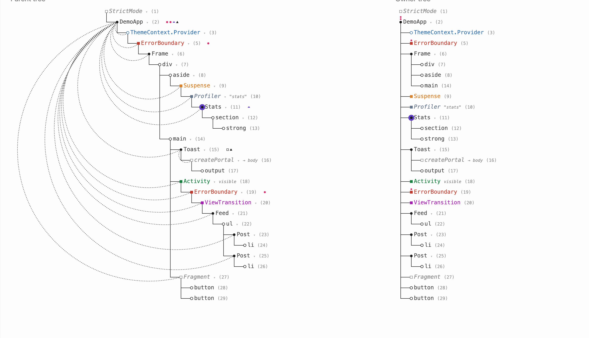
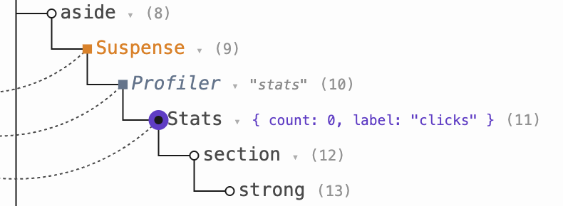
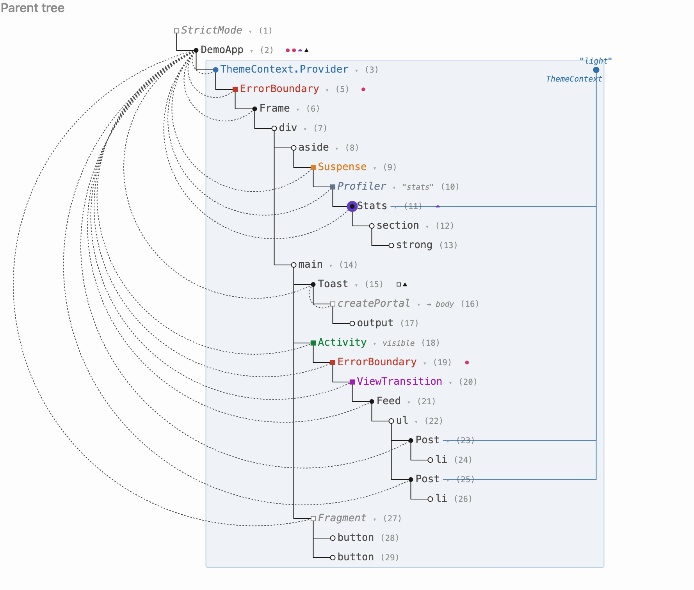

# react-parent-owner-trees

Live diagrams of a running React app, in the notation from [A Visual
Notation for React's Parent and Owner
Trees](https://julesblom.com/writing/react-visual-notation). The library
draws two SVG trees:

- **Parent tree** — where each component's output lands in the markup.
- **Owner tree** — which component rendered which. An element's owner is
  the component whose JSX created it, so owner edges show where props come
  from.

None of this structure lives in a single file — which component owns which,
where props come from, what a boundary scopes — so reading it from code
means reconstructing it in working memory. A picture can hold it for you.
The post draws that picture by hand; this library draws it from your app.

Think [react-scan](https://github.com/aidenybai/react-scan), but instead of
highlighting re-renders it shows the whole app as the two trees. Built on
[bippy](https://github.com/aidenybai/bippy), the fiber-access layer
extracted from react-scan.



*The demo app as its two trees. In the parent tree, `Stats` and the
`Post`s sit inside `Frame`'s markup, but the dashed arcs show `DemoApp`
owns them — and the owner tree on the right makes that the structure:
slot composition, exactly where the two trees diverge.*

Live extraction needs a **development build of React 19** — production
builds strip owner information. The static walker (below) also works in
production builds and at build time.

## Install

```sh
npm install react-parent-owner-trees bippy
```

`bippy` is an optional peer dependency: only the `/extract` entry needs it.
If you only render diagrams from your own data, or only use the static
walker, skip it.

## Quick start: script tag

The standalone build attaches a tree panel to any dev-mode React app. Serve
`dist/auto.global.js` from your page and load it as a **classic script in
`<head>`, before your app bundle**:

```html
<script src="/auto.global.js"></script>
```

It adds a fixed panel with both trees, updated on every commit, plus a
`hide` button and a badge to bring the panel back. The script must load
first so bippy can install the React DevTools hook before react-dom
initializes.

## Quick start: in your own page

The package has three entry points:

| Entry | What it gives you | Dependencies |
| --- | --- | --- |
| `react-parent-owner-trees/core` | `createTreeRenderer` and the `InputNode` type | none |
| `react-parent-owner-trees/extract` | `startExtraction` — live fiber extraction, one tree per commit | bippy, react (dev build) |
| `react-parent-owner-trees/static` | `elementToTree` — element walker, no DOM needed | react |

Wire extract to core like this:

```ts
// Import order matters: extract must be imported before react-dom,
// anywhere in your module graph. See "Import order" below.
import { startExtraction, contextName } from "react-parent-owner-trees/extract";
import { createTreeRenderer } from "react-parent-owner-trees/core";

const renderer = createTreeRenderer({ sizing: "fixed", contextName });

startExtraction((roots, diff, rendered) => {
  document.getElementById("parent")!.innerHTML = renderer.parentTreeSvg(
    roots,
    rendered,
  );
  document.getElementById("owner")!.innerHTML = renderer.ownerTreeSvg(
    roots,
    rendered,
  );
});
```

`startExtraction` calls you back on every React commit with an
`InputNode[]`, a `TreeDiff` against the previous snapshot, and the set of
node ids that actually performed work in the commit (bailed-out
reconciliation visits don't count). Pass that set to the SVG methods and
the rows that rendered blink once, subtly — ambient liveness in the
Observable-minimap sense. It's per-call data, not renderer state: pass it
only on commit-triggered renders, so your own interaction re-renders
don't replay the blink. The renderer turns it all into SVG strings; you
put them in the DOM.

### Import order

bippy installs the React DevTools hook as a side effect of being imported.
React checks for that hook exactly once, when react-dom first evaluates —
if the hook is not there yet, extraction stays silent forever. So the
`/extract` entry (or the script tag) must load before anything that imports
react-dom:

```ts
import "react-parent-owner-trees/extract"; // first
import { createRoot } from "react-dom/client"; // after
```

If the order is wrong, `startExtraction()` logs a `console.error`
explaining the problem after a short grace period.

## Static figures

`elementToTree` walks a React element tree without rendering it to the DOM.
It calls your component functions with a mock hooks dispatcher, so it works
at build time, in tests, and with production React:

```tsx
import { elementToTree, contextName } from "react-parent-owner-trees/static";
import { createTreeRenderer } from "react-parent-owner-trees/core";

const roots = elementToTree(<App />);
const renderer = createTreeRenderer({ sizing: "content", contextName });
const svg = renderer.parentTreeSvg(roots);
```

Options: `elementToTree(root, prefix, { rsc, suspended, errored })`.
`rsc` treats the tree as a server-component program (mark client entry
points with `markUseClient`), `suspended` draws every Suspense boundary
showing its fallback, and `errored` forces every error boundary into its
caught state. Useful for drawing figures of states that are hard to catch
live.

## Renderer options

`createTreeRenderer(options)` returns a renderer instance that owns all
interactive state (selection, folds, active areas), so several diagrams on
one page never share toggles.

| Option | Default | Meaning |
| --- | --- | --- |
| `sizing` | `"content"` | `"content"` sizes the SVG to the widest row (figures); `"fixed"` keeps a stable width (live tool, where rows churn every commit) |
| `select` | on | click a node to focus its neighborhood; click again or press Escape to clear |
| `collapse` | off | disclosure triangles and double-click subtree collapse |
| `hooks` | off | per-component hook strips, one glyph per hook call |
| `serverRegions` | off | tinted regions behind server-component rows |
| `sourceNav` | off | `data-node` attributes and a cmd-click source hint |
| `serverColor` | a teal (`hsl(191 65% 40%)`) | the "came from the server" color |
| `contextName` | — | resolves a context id to a display name; pass the `contextName` export of whichever producer you use |

## Interaction

The renderer returns plain SVG strings and never touches the DOM.
Interactivity is wired by you: listen for clicks on your container, find
the closest element with one of these data attributes, call the matching
renderer method, then re-render both trees.

| Data attribute | Renderer method |
| --- | --- |
| `data-select-toggle` | `toggleSelect(id)` |
| `data-fold-toggle` | `toggleFold(id)` |
| `data-collapse-toggle` | `toggleCollapse(id)` |
| `data-context-toggle` | `toggleContext(id)` |
| `data-boundary-toggle` | `toggleBoundary(id)` |
| `data-memo-toggle` | `toggleMemo(id)` |
| `data-hooks-toggle` | `toggleHooks(id)` |

There are also direct setters — `setArcStyle`, `setHooksMode`, `setMarks`,
`clearSelect`, and `set*Active` variants of the toggles. See the
`TreeRenderer` type for the full interface.

## What the diagrams show

- **Circles** — filled for components, hollow for DOM nodes. Solid elbows
  are parent structure; dashed arcs are owner edges, pointing back to where
  the props come from.
- **State dots** — small red dots above a component, one per
  useState/useReducer.
- **Memo discs** — `React.memo` components sit in a violet disc; owner
  arcs end at the disc, because props are delivered to the comparison gate.
  Click the disc to see the memoized props the next comparison runs
  against.

  
- **Context providers** — colored rows (the context needs a
  `displayName`). Click one to tint its scope, show its current value, and
  draw delivery lines to every component that reads it.

  
- **Suspense and error boundaries** — colored rings. Click one to tint
  exactly the region it catches (its subtree minus nested boundaries of
  the same kind). Suspended boundaries get a `suspended` badge; subtrees
  unmounted by a crash are drawn dashed as what stood there before.
- **Server components (RSC)** — React 19 server components appear as
  italic rows in the server color, with regions behind contiguous server
  rows and `'use client'` badges on the client entry points.
- **`<Activity>`, `<Profiler>`, portals, `React.lazy`, Fragment,
  StrictMode** — all get rows with their own marks; hidden `<Activity>`
  subtrees render dimmed.
- **Folding** — runs of four or more same-named siblings fold into one row
  with a `×n` badge; click to unfold.
- **Selection focus** — click any node to keep its neighborhood (two
  levels up and down, plus its direct owner and ownees) at full strength
  while everything else fades in place; layout never shifts.

## Known limitations

- Live extraction works only with development builds of React 19.
- If a selected node's owner sits inside a folded run, that owner arc is
  not drawn (unfolding on selection is planned).

## Development

```sh
npm install
npm run dev     # demo app + live tool
npm test        # renderer snapshots + unit tests
npm run build:lib && npm run build:auto
```

The library lives in `src/lib/`; `src/main.tsx` and `src/demo/` are the
dev app the tool observes. Design decisions are recorded in `docs/adr/`,
the domain vocabulary in `CONTEXT.md`.

## License

MIT
